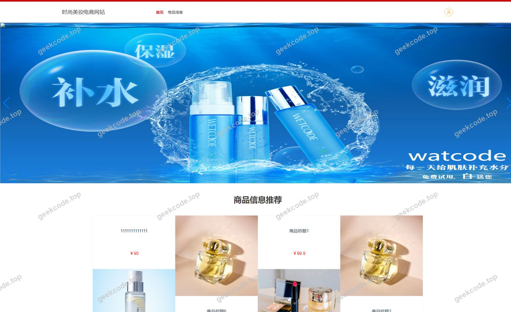
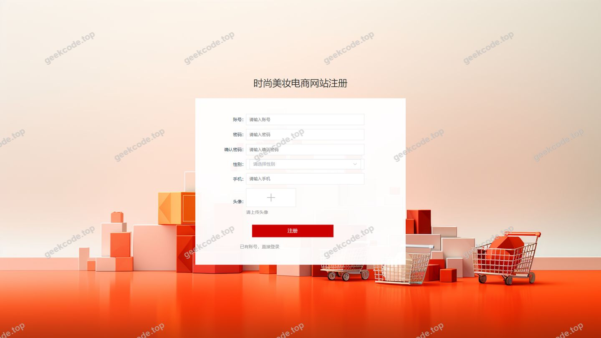
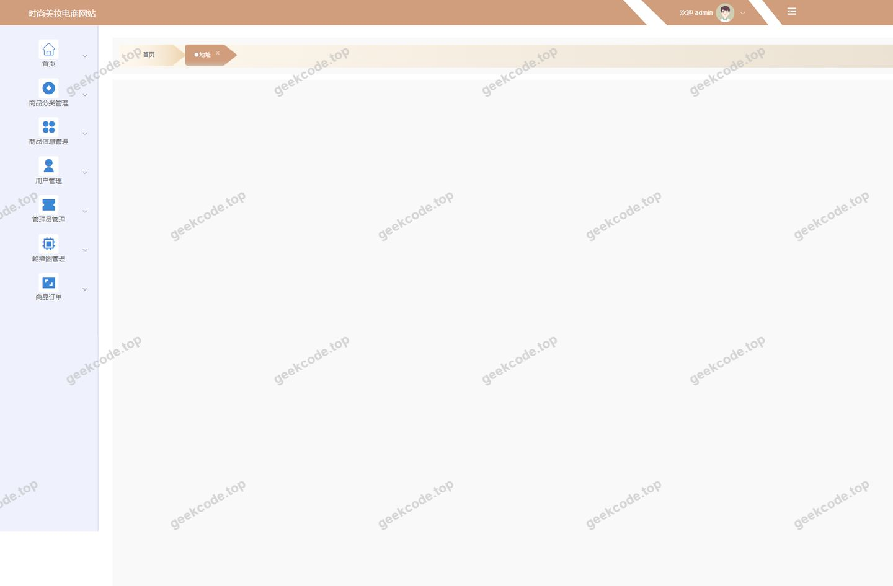
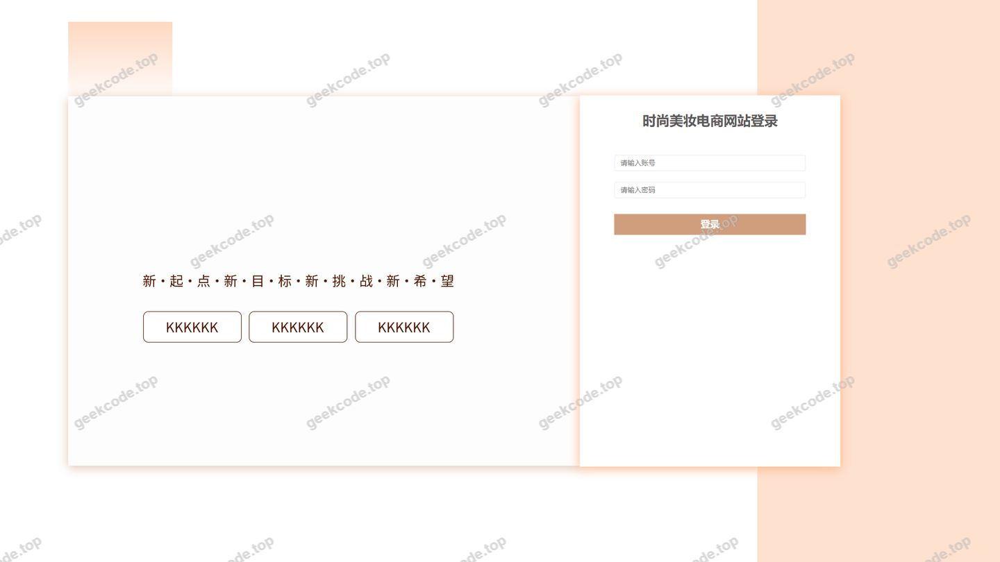
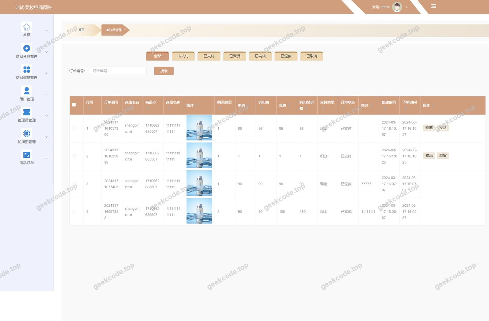
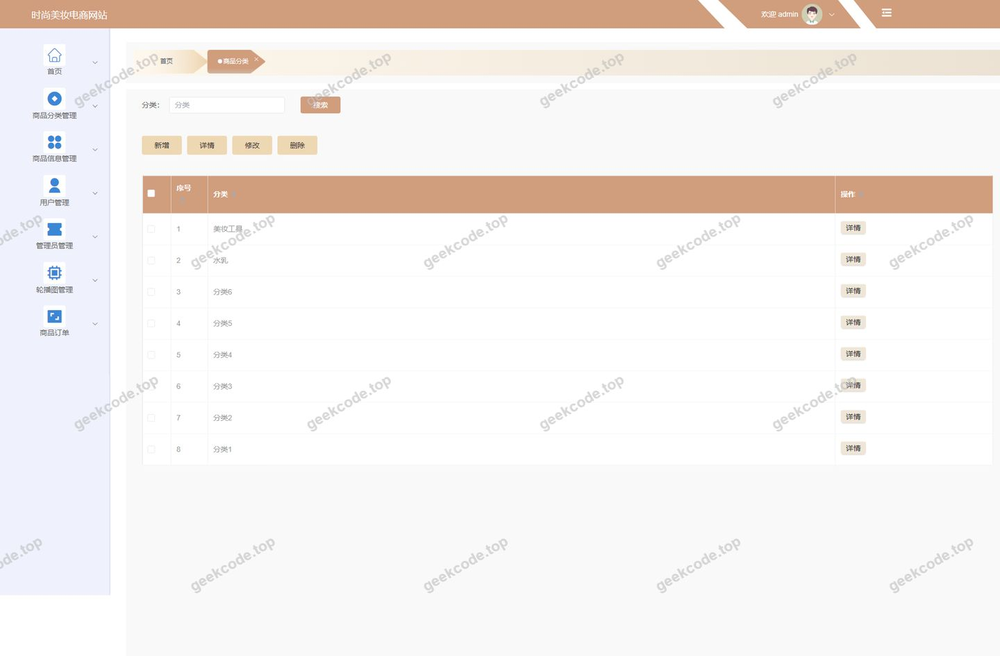
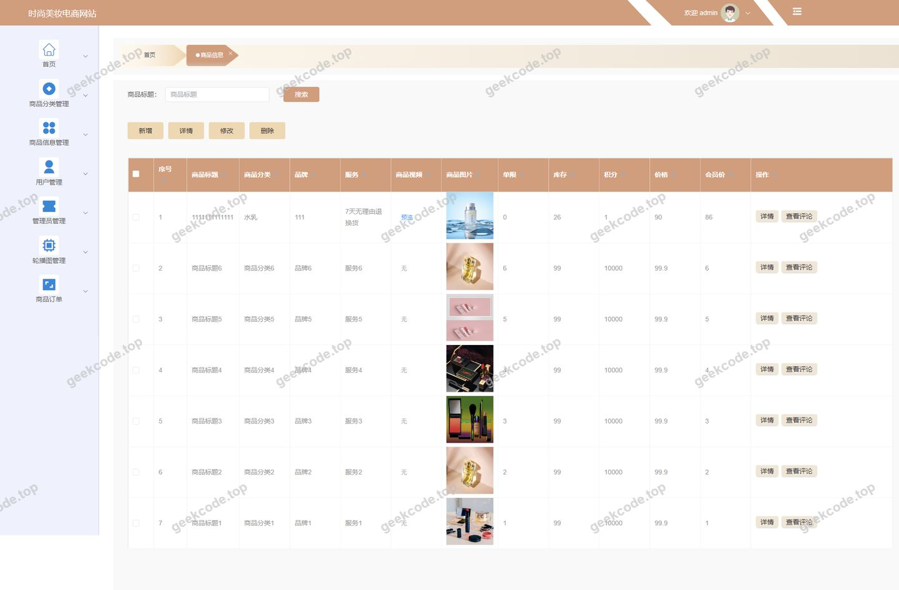
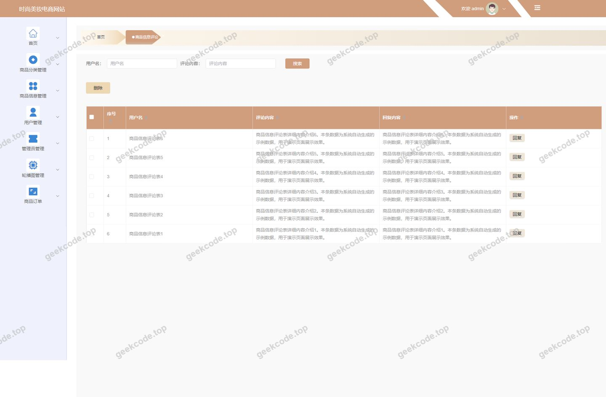
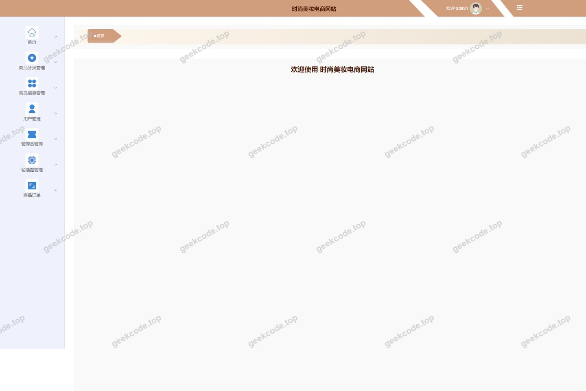
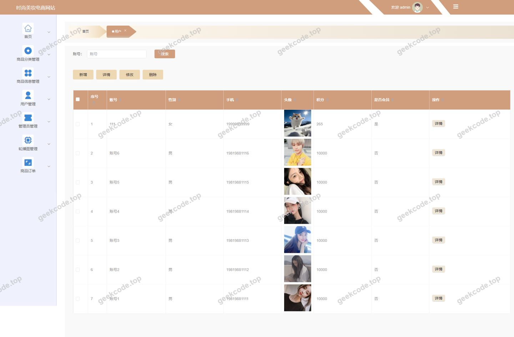

# 时尚美妆电商网站

> 🎓 **计算机毕业设计 · 时尚美妆电商网站**
>
> 本仓库只放**项目介绍 + 运行截图**（截图是站点带水印的原图，存在仓库 `images/` 里）。
>
> 👉 **完整可运行源码 / 数据库脚本 / 部署文档：[点我获取](https://geekcode.top/archives/%E6%97%B6%E5%B0%9A%E7%BE%8E%E5%A6%86%E7%94%B5%E5%95%86%E7%BD%91%E7%AB%99?utm_source=github)**
>
> 💬 咨询微信：**ir9372**　|　🌐 更多项目：[极客代码 geekcode.top](https://geekcode.top/?utm_source=github)
>
> 📌 项目详情页：<https://geekcode.top/archives/%E6%97%B6%E5%B0%9A%E7%BE%8E%E5%A6%86%E7%94%B5%E5%95%86%E7%BD%91%E7%AB%99?utm_source=github>

<table><td width="230" align="center"> <b>扫码加微信 ir9372</b></td><td valign="middle">📦 源码 = 项目介绍 + 全部运行截图 + 数据库 + 部署文档 👉 点上方任意截图，直接跳到 <b>极客代码 geekcode.top</b> 详情页</td></table>

---

<h1>时尚美妆电商网站</h1>
<h2>项目概述</h2>

本项目旨在构建一个基于 Web 的时尚美妆电商平台，解决传统线下美妆零售信息不对称及线上购物流程繁琐的问题。系统采用前后端分离架构，提供完整的商品展示、分类浏览、购物车管理、订单处理及用户中心功能。核心业务涵盖商品信息管理、用户注册登录、地址维护、商品评论互动以及后台数据监控。适用人群包括普通消费者（前台用户）和平台运营人员（后台管理员）。技术架构上，后端选用 Spring Boot 框架结合 MyBatis-Plus 进行高效数据持久化，使用 Shiro 实现安全权限控制；前端基于 Vue 框架开发，确保良好的用户体验与交互响应速度。该系统具备高内聚低耦合特性，易于扩展与维护，适用于中小型电商业务的快速部署与迭代。

<h2>技术架构</h2>

本项目采用经典的前后端分离架构设计，整体技术栈成熟稳定，具备良好的可维护性与扩展性。

<strong>1. 后端架构</strong>
后端核心框架为 <strong>Spring Boot</strong>，利用其自动配置特性简化了项目搭建与依赖管理。数据访问层采用 <strong>MyBatis-Plus</strong>，在保留 MyBatis 灵活 SQL 编写能力的同时，提供了强大的 CRUD 接口封装，显著提升了开发效率。数据库连接通过 <code>mysql-connector-java</code> 驱动实现，底层使用 MySQL 存储业务数据。安全认证与授权模块集成 <strong>Apache Shiro</strong>，负责处理用户登录状态保持、会话管理及细粒度的权限校验。此外，引入 <code>commons-lang3</code> 工具类库以增强代码健壮性，并使用 <code>validation-api</code> 实现后端参数合法性校验。

<strong>2. 前端架构</strong>
前端采用 <strong>Vue.js</strong> 框架进行页面渲染与逻辑处理，通过 Axios 等 HTTP 客户端与后端 RESTful API 进行异步数据交互。项目结构清晰，组件化开发模式使得界面复用率高，便于维护复杂的电商页面布局（如商品列表、详情页、购物车等）。

<strong>3. 数据库设计要点</strong>
数据库设计遵循第三范式，主要实体包括：

<ul>
<li><strong>用户表 (yonghu)</strong>：存储注册用户基本信息。</li>
<li><strong>管理员表 (users)</strong>：存储后台管理人员账号。</li>
<li><strong>商品信息表 (shangpinxinxi)</strong>：核心业务表，存储美妆产品的名称、价格、库存、图片及详情描述。</li>
<li><strong>商品分类表 (shangpinfenlei)</strong>：用于对商品进行层级化管理。</li>
<li><strong>订单表 (orders)</strong>：记录交易流水，包含订单状态、金额及关联用户。</li>
<li><strong>购物车表 (cart)</strong>：临时存储用户选购但未结算的商品。</li>
<li><strong>收货地址表 (address)</strong>：关联用户与具体的配送地址信息。</li>
<li><strong>收藏表 (storeup)</strong>：记录用户对商品的收藏行为。</li>
<li><strong>评论表 (discussshangpinxinxi)</strong>：存储用户对已购或浏览商品的反馈信息。</li>
</ul>

<strong>4. 核心技术选型理由</strong>
选择 Spring Boot + MyBatis-Plus 组合是因为其在 Java 生态中拥有庞大的社区支持和高度的稳定性，适合快速构建企业级应用。Shiro 相比 Spring Security 配置更为轻量且直观，适合中小型项目的权限管理需求。Vue 作为渐进式框架，能够无缝集成到现有项目中，提升前端开发体验。

<h2>功能模块</h2>

根据路由配置与截图所示，系统功能划分为前台用户端与后台管理端两大模块。

<h3>前台用户端</h3>

前台主要面向普通消费者，提供完整的购物体验闭环。

<ol>
<li><strong>首页与商品浏览</strong></li>
</ol>
<ul>
<li><strong>首页展示</strong>：展示热门美妆产品推荐、轮播图及最新上架商品。</li>
<li><strong>商品列表 (<code>/index/shangpinxinxiList</code>)</strong>：支持按分类筛选、关键字搜索查看商品集合。</li>
<li><strong>商品详情 (<code>/index/shangpinxinxiDetail</code>)</strong>：展示单个商品的详细信息、图片、价格、库存及用户评论区。</li>
<li><strong>商品分类 (<code>/index/shangpinfenleiList</code>, <code>/index/shangpinfenleiDetail</code>)</strong>：查看不同类别的美妆产品及其细分介绍。</li>
</ul>
<ol start="2">
<li><strong>用户账户体系</strong></li>
</ol>
<ul>
<li><strong>用户注册 (<code>/yonghuRegister</code>)</strong>：新用户填写基本信息完成账号创建。</li>
<li><strong>用户登录</strong>：已注册用户通过账号密码进入个人中心。</li>
<li><strong>个人中心 (<code>/index/yonghuCenter</code>)</strong>：查看个人基本资料、修改个人信息。</li>
<li><strong>用户列表 (<code>/index/yonghuList</code>)</strong>：(注：通常此路由在前台可能指代特定场景下的用户可见列表或测试路由，依据常规电商逻辑，此处主要服务于用户自身信息查看)。</li>
<li><strong>用户详情 (<code>/index/yonghuDetail</code>)</strong>：查看具体用户的公开信息（若涉及社交属性）或个人档案细节。</li>
</ul>
<ol start="3">
<li><strong>交易核心流程</strong></li>
</ol>
<ul>
<li><strong>购物车 (<code>/index/cartList</code>)</strong>：添加、删除、修改数量，预览待结算商品清单。</li>
<li><strong>地址管理 (<code>/index/addressList</code>)</strong>：新增、编辑、删除收货地址，设置默认地址。</li>
<li><strong>订单确认 (<code>/index/order_confirm</code>)</strong>：核对下单商品、选择收货地址、确认支付方式。</li>
<li><strong>我的订单 (<code>/index/ordersList</code>)</strong>：查看历史订单状态（待付款、待发货、已完成等）。</li>
</ul>
<ol start="4">
<li><strong>互动与收藏</strong></li>
</ol>
<ul>
<li><strong>我的收藏 (<code>/index/storeupList</code>)</strong>：查看用户收藏的心仪商品。</li>
<li><strong>商品评论 (<code>/index/discussshangpinxinxiAdd</code> - 隐含于详情页)</strong>：用户在商品详情页发表购买心得或使用评价。</li>
</ul>
<h3>后台管理端</h3>

后台面向平台管理员，提供全面的数据管理与系统配置功能。

<ol>
<li><strong>基础信息管理</strong></li>
</ol>
<ul>
<li><strong>用户管理 (<code>/yonghu</code>)</strong>：查看前台注册用户列表，执行禁用、启用或删除操作。</li>
<li><strong>管理员管理 (<code>/users</code>)</strong>：管理系统内部操作人员账号，分配角色权限。</li>
<li><strong>商品分类管理 (<code>/shangpinfenlei</code>)</strong>：增删改查美妆产品的分类目录，维护分类层级。</li>
</ul>
<ol start="2">
<li><strong>商品运营管理</strong></li>
</ol>
<ul>
<li><strong>商品信息 (<code>/shangpinxinxi</code>)</strong>：发布新商品，编辑商品标题、价格、库存、上传图片及详细描述，下架违规商品。</li>
<li><strong>商品评论 (<code>/discussshangpinxinxi</code>)</strong>：审核用户提交的评论内容，屏蔽不良信息，回复官方咨询。</li>
</ul>
<ol start="3">
<li><strong>交易与物流管理</strong></li>
</ol>
<ul>
<li><strong>订单管理 (<code>/orders</code>)</strong>：查看所有订单详情，执行发货操作，处理退款申请，统计销售数据。</li>
<li><strong>地址管理 (<code>/address</code>)</strong>：查看用户收货地址分布情况（主要用于数据统计或异常排查，一般不直接修改用户隐私地址，除非必要客服介入）。</li>
</ul>
<ol start="4">
<li><strong>系统配置</strong></li>
</ol>
<ul>
<li><strong>系统配置 (<code>/config</code>)</strong>：设置网站基本信息、轮播图配置、客服电话等全局参数。</li>
<li><strong>购物车监控 (<code>/cart</code>)</strong>：查看当前在线用户的购物车滞留情况（辅助营销分析）。</li>
</ul>
<h2>用户角色与权限</h2>

系统基于 Apache Shiro 实现权限控制，主要定义两类角色：<strong>前台普通用户</strong> 和 <strong>后台管理员</strong>。

<table>
<thead>
<tr>
<th align="left">角色名称</th>
<th align="left">身份标识</th>
<th align="left">可访问模块/功能</th>
<th align="left">权限描述</th>
</tr>
</thead>
<tbody><tr>
<td align="left"><strong>前台普通用户</strong></td>
<td align="left">User</td>
<td align="left"><strong>公共区域</strong>1. 首页浏览2. 商品列表/详情/分类查看3. 用户注册<strong>个人专属区域</strong>1. 个人中心（资料修改）2. 购物车管理（增删改查）3. 收货地址管理（增删改查）4. 订单查询与确认5. 商品收藏管理6. 商品评论发表</td>
<td align="left">仅能查看公开的商品信息。只能操作与自己账号绑定的数据（如自己的订单、地址、购物车）。无权访问任何后台管理接口。</td>
</tr>
<tr>
<td align="left"><strong>后台管理员</strong></td>
<td align="left">Admin</td>
<td align="left"><strong>系统管理</strong>1. 管理员账号维护2. 系统全局配置<strong>业务管理</strong>1. 用户信息管理2. 商品分类维护3. 商品信息全生命周期管理（发布/编辑/下架）4. 订单全流程处理（发货/退款）5. 评论审核与管理6. 地址数据查看7. 购物车数据查看</td>
<td align="left">拥有最高权限，可访问所有后台路由。可对全站数据进行增删改查操作。负责平台内容的合规性与交易的正常流转。不可直接参与前台购物流程（通常需切换身份或使用专用测试账号）。</td>
</tr>
</tbody></table>

<strong>权限控制逻辑说明：</strong>

<ul>
<li><strong>未登录用户</strong>：仅允许访问首页、商品列表、商品详情、注册页面。点击“加入购物车”、“立即购买”或进入“个人中心”时，系统将拦截并重定向至登录页。</li>
<li><strong>已登录用户</strong>：解锁个人中心、购物车、订单、收藏及评论功能。Shiro 过滤器验证 Session 有效性，确保只有本人能修改自己的数据。</li>
<li><strong>管理员</strong>：通过独立的后台登录入口进入，Session 中包含 ADMIN 角色标识。所有后台路由均受 Shiro 注解保护，非管理员角色访问将返回 403 Forbidden。</li>
</ul>
<h2>项目特色与创新点</h2>
<ol>
<li>
<strong>垂直领域定制化设计</strong>
   区别于通用型电商模板，本项目针对“时尚美妆”行业特性进行了优化。例如，在商品分类管理中强化了品类层级，适应美妆产品多品牌、多系列的特点；在商品详情页预留了丰富的图文展示空间，符合美妆产品重视觉、重种草的消费心理。

</li>
<li>
<strong>完整的安全防护体系</strong>
   集成 Apache Shiro 框架，实现了从身份认证（Authentication）到授权（Authorization）的全链路安全管控。不仅区分了前后台访问权限，还通过 Session 管理和 CSRF 防护机制，保障了用户隐私数据（如地址、订单）的安全性，防止越权访问。

</li>
<li>
<strong>高效的数据持久化方案</strong>
   采用 MyBatis-Plus 替代传统 MyBatis，大幅减少了样板代码（Boilerplate Code）的编写。通过其提供的条件构造器和分页插件，在处理商品列表筛选、订单历史记录查询等高频复杂 SQL 场景时，既保证了灵活性又提升了开发效率。

</li>
<li>
<strong>前后端分离的现代化架构</strong>
   摒弃传统的 JSP/Thymeleaf 服务端渲染模式，采用 Vue + Spring Boot 的 RESTful API 交互方式。这种架构使得前端界面更加流畅，支持局部刷新，提升了用户在浏览商品、加入购物车时的响应速度；同时也便于未来扩展移动端（App/小程序）接入，只需复用后端接口即可。

</li>
<li>
<strong>闭环的用户体验流程</strong>
   从“发现商品 -&gt; 查看详情 -&gt; 加入购物车 -&gt; 确认订单 -&gt; 支付/提交 -&gt; 评论反馈 -&gt; 再次复购/收藏”构建了完整的电商业务闭环。特别是加入了“商品评论”与“收藏”功能，增强了用户粘性与社区互动属性，有助于形成良好的口碑传播效应。

</li>
</ol>
<h2>部署环境</h2>

为确保项目正常运行，建议配置以下软硬件环境：

<strong>1. 硬件要求</strong>

<ul>
<li>CPU: Intel Core i5 及以上</li>
<li>内存: 8GB RAM 及以上</li>
<li>硬盘: 至少 50GB 可用空间（用于存储图片资源及数据库文件）</li>
</ul>

<strong>2. 软件环境</strong>

<ul>
<li><strong>操作系统</strong>: Windows 10/11, macOS, 或 Linux (CentOS 7+/Ubuntu 20.04+)</li>
<li><strong>JDK</strong>: Java Development Kit 1.8 (JDK 8) 或更高版本（推荐 JDK 8 以兼容 Spring Boot 旧版依赖）</li>
<li><strong>数据库</strong>: MySQL 5.7 或 MySQL 8.0</li>
<li><strong>构建工具</strong>: Maven 3.6+ （用于后端依赖管理与打包）</li>
<li><strong>Node.js</strong>: v14.x 或 v16.x LTS 版本 （用于前端 Vue 项目依赖安装与编译）</li>
<li><strong>Web 服务器</strong>: Nginx (可选，用于生产环境静态资源代理) 或 Tomcat (Spring Boot 内置)</li>
</ul>

<strong>3. 开发工具 (IDE)</strong>

<ul>
<li>后端开发: IntelliJ IDEA Community/Ultimate 或 Eclipse</li>
<li>前端开发: Visual Studio Code (VS Code)</li>
<li>数据库管理: Navicat for MySQL 或 DBeaver</li>
</ul>

<strong>4. 启动步骤简述</strong>

<ol>
<li>安装并启动 MySQL 服务，创建数据库并导入项目提供的 <code>.sql</code> 初始化脚本。</li>
<li>修改后端 <code>application.yml</code> 配置文件中的数据库连接 URL、用户名和密码。</li>
<li>使用 Maven 命令 <code>mvn clean package</code> 编译后端项目，生成 jar 包或直接运行主类启动后端服务（默认端口通常为 8080）。</li>
<li>进入前端项目目录，执行 <code>npm install</code> 安装依赖。</li>
<li>执行 <code>npm run serve</code> (开发环境) 或 <code>npm run build</code> (生产环境) 启动前端服务（默认端口通常为 8081 或 3000）。</li>
<li>浏览器访问前端地址即可使用系统。</li>
</ol>
<h2>五、技术特性</h2>
<ul>
<li>前后端集成部署，前端资源打包至后端 static 目录</li>
<li>使用 MyBatis-Plus 简化数据访问层开发</li>
<li>集成 Shiro 权限框架实现角色权限控制</li>
</ul>
<h2>六、功能模块截图</h2>
<h3>前台用户端</h3>
<h4>前台-首页</h4>

<h4>前台-登录</h4>

<h4>前台-用户注册</h4>

<h3>后台管理端</h3>
<h4>后台-地址</h4>

<h4>后台-登录页</h4>

<h4>后台-订单管理</h4>

<h4>后台-商品分类</h4>

<h4>后台-商品信息</h4>

<h4>后台-商品信息评论</h4>

<h4>页面-首页</h4>

<h4>后台-用户</h4>

---

## 获取完整源码

| 项目 | 说明 |
| --- | --- |
| 项目名 | 时尚美妆电商网站 |
| 运行截图 | 本文 11 张（站点带水印原图，仓库 `images/` 目录） |
| 完整源码 | [https://geekcode.top/archives/%E6%97%B6%E5%B0%9A%E7%BE%8E%E5%A6%86%E7%94%B5%E5%95%86%E7%BD%91%E7%AB%99?utm_source=github](https://geekcode.top/archives/%E6%97%B6%E5%B0%9A%E7%BE%8E%E5%A6%86%E7%94%B5%E5%95%86%E7%BD%91%E7%AB%99?utm_source=github) |
| 咨询微信 | **ir9372**（备注：jingpin-yuanma） |
| 更多项目 | [极客代码 geekcode.top](https://geekcode.top/?utm_source=github) |

> 需要源码、部署、改配置、跑不起来等问题，加微信 ir9372 沟通，说明项目名即可。
